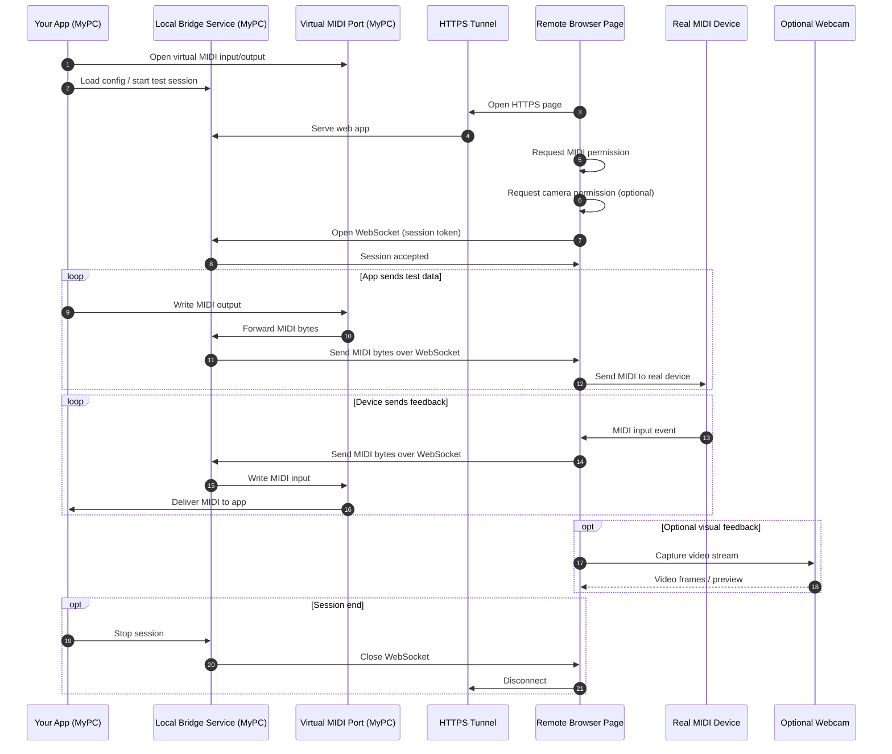

# Remote MIDI access

Let a remote user’s browser access a MIDI device and optional webcam, while your app on your PC drives test iterations and receives feedback, without installing anything on the remote PC.

## High-level architecture

`Your App <-> Local Bridge Service <-> Virtual MIDI Port`

`Remote Browser Page <-> WebSocket <-> Local Bridge Service`

`Remote Browser Page -> real MIDI device + optional webcam`

## Components

### 1) Remote browser page
Runs in the user’s browser on the remote PC.

Responsibilities:
- Request MIDI permission
- Request camera permission if needed
- Open a WebSocket back to your PC
- Translate between:
  - WebSocket messages
  - Web MIDI messages
  - optional camera preview/status

What it does not do:
- It does not contain your core app logic
- It does not store config permanently
- It does not need installation

### 2) Tunnel / public entrypoint
A secure HTTPS URL that points to your local server.

Responsibilities:
- Expose your local web app to the remote browser
- Provide TLS
- Optionally restrict access by login/token/IP/expiry

This is just for loading the page and/or reaching the WebSocket endpoint.

### 3) Local bridge service on your PC
A small service you run locally.

Responsibilities:
- Serve the bridge page and API
- Accept WebSocket connections from the remote browser
- Maintain session state
- Forward MIDI data to/from a virtual MIDI port
- Enforce auth/session matching
- Optionally proxy camera metadata or still frames if you need them

### 4) Virtual MIDI port
A local virtual MIDI input/output endpoint your app can open like a normal device.

Responsibilities:
- Make the remote hardware appear local to your app
- Receive MIDI from the bridge
- Send MIDI back to the bridge

Your app should not know or care that the real device is remote.

### 5) Your app
Your existing application.

Responsibilities:
- Generate config files
- Open the virtual MIDI port
- Send test traffic
- React to device feedback
- Iterate config until correct

## Message flow

### From your app to the remote device
1. Your app writes MIDI to the virtual output port
2. Bridge service reads it
3. Bridge sends MIDI bytes over WebSocket
4. Remote browser receives bytes
5. Browser sends them to the real MIDI output device

### From the remote device back to your app
1. Real MIDI input device emits data
2. Browser receives MIDI event
3. Browser forwards bytes over WebSocket
4. Bridge service receives them
5. Bridge writes them to the virtual input port
6. Your app receives them

## WebSocket protocol

Keep it very small and explicit.

Suggested message types:

- `hello`
- `auth`
- `session-join`
- `midi-in`
- `midi-out`
- `camera-status`
- `device-list`
- `error`
- `ping` / `pong`

Example:
```json
{ "type": "hello", "sessionId": "abc123" }
{ "type": "auth", "token": "..." }
{ "type": "midi-in", "data": [240, 125, 1, 2, 247] }
{ "type": "midi-out", "data": [144, 60, 127] }
```

For SysEx, send raw byte arrays.

## Session model

Use a single test session per run.

Each session has:
- `sessionId`
- `short-lived token`
- `status`
- `connected devices`
- `last activity`
- `expiry time`

Rules:
- Remote browser must join using the session token
- Only one active remote endpoint per session unless you want multi-client support
- Expire idle sessions automatically

## Security model

Use all of these:
- HTTPS tunnel
- short-lived session token
- one-time join code or signed URL
- origin checks on WebSocket
- explicit browser permission prompts for MIDI and camera
- no persistent secrets in the page

If possible:
- make the tunnel URL temporary
- rotate tokens each session
- require the user to confirm device sharing each time

## Optional webcam support

If you want visual feedback:
- remote page requests camera permission
- show live preview in the browser
- optionally send status snapshots or lightweight metadata to your PC

Simplest approach:
- keep video local to the remote browser page
- use it for human feedback only

If you truly need video on your PC:
- add a second channel for frames or stream the camera via WebRTC
- but that’s more complex than needed for most MIDI testing

## Recommended implementation stack

### Local bridge service
- Node.js
- `ws` or `Socket.IO`
- MIDI library for your OS
- static server for the web page

### Remote page
- plain HTML/JS
- Web MIDI API
- WebSocket client
- optional `getUserMedia()`

### Tunnel
- Cloudflare Tunnel or ngrok

## Minimal runtime sequence

1. Start local bridge service
2. Start tunnel
3. Generate session token
4. Send remote user the HTTPS link
5. Remote user opens page
6. User approves MIDI/camera
7. Page connects to bridge over WebSocket
8. Your app opens the virtual MIDI port
9. Test messages flow both ways
10. Repeat until config is correct

## Practical advice

- Treat the bridge as a **MIDI router**
- Keep config files and device state on your side only
- Use a per-session log of every MIDI message
- Add a “record/replay” mode so you can test configs deterministically
- Start with MIDI only; add camera afterward

---

